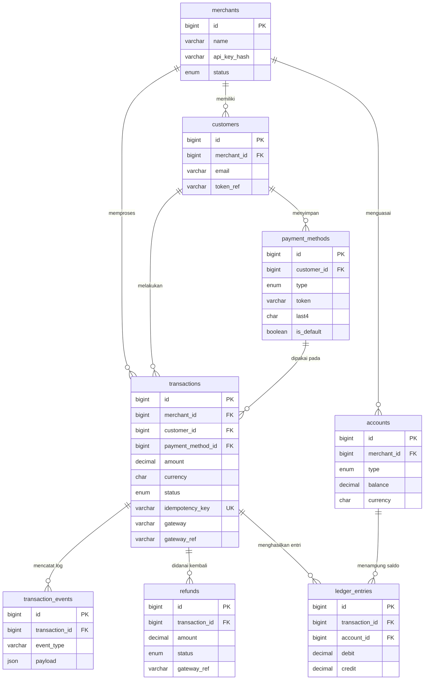

# Laporan Riset Payment Gateway

> Perbandingan komprehensif gateway pembayaran open-source dan tier gratis komersial, diperingkatkan berdasarkan biaya, kecepatan, dan skalabilitas. Mencakup pola arsitektur, kepatuhan keamanan PCI DSS 4.0, perancangan basis data 3NF, diagram UML/ER, serta rekomendasi teknis untuk aplikasi E-Commerce Laravel.

---

## Daftar Isi

- [1. Ringkasan Eksekutif](#1-ringkasan-eksekutif)
- [2. Kategori Gateway Pembayaran](#2-kategori-gateway-pembayaran) — 53 gateway dalam 7 kategori
- [3. Tabel Peringkat (Rankings)](#3-tabel-peringkat-rankings) — Biaya Terendah, Tercepat, Paling Skalabel
- [4. Arsitektur & Pola Desain (Design Patterns)](#4-arsitektur--pola-desain-design-patterns)
- [5. Keamanan & PCI DSS 4.0](#5-keamanan--pci-dss-40)
- [6. Arsitektur Basis Data (3NF & Double-Entry Ledger)](#6-arsitektur-basis-data-3nf--double-entry-ledger)
- [7. Rekomendasi Khusus untuk Proyek Ini](#7-rekomendasi-khusus-untuk-proyek-ini)

### Dataset & Berkas Ekspor

- **Dataset JSON**: [`gateways.json`](gateways.json) — Data lengkap 53 gateway dalam format JSON untuk analisis terprogram.
- **Ekspor CSV**: [`gateways.csv`](gateways.csv) — Dataset tabel datar untuk filter Excel / Google Sheets.
- **Indeks Direktori Kategori**: [`gateways/README.md`](gateways/README.md) — Hub navigasi kategori A sampai G.
- **Indeks Laporan Individual**: [`gateways/individual/README.md`](gateways/individual/README.md) — Tabel indeks 53 laporan mandiri.
- **Studi Kasus & Blueprint Arsitektur**: [`../payment-gateway-reports/README.md`](../payment-gateway-reports/README.md) — Audit tech stack Solosmartpay, dekomposisi upstream Duitku, dan blueprint gateway lean SNAP BI (hemat 40%–80%).

### Laporan Kategori Lengkap

| Kategori | Dokumen | Gateway yang Dicakup |
|---|---|---|
| **A. Payment Orchestrators** | [Lihat →](gateways/A-payment-orchestrators.md) | Hyperswitch, Hyperswitch Prism, OwnPay, PipraPay |
| **B. Self-Hosted Crypto Gateways** | [Lihat →](gateways/B-crypto-gateways.md) | BTCPay Server, Bitcart, SHKeeper, CryptoPayServer, Globee |
| **C. Billing & Subscription Platforms** | [Lihat →](gateways/C-billing-subscription-platforms.md) | Kill Bill, Lago, OpenMeter, FOSSBilling, Invoice Ninja, Crater, SolidInvoice |
| **D. Payment SDK Libraries** | [Lihat →](gateways/D-payment-sdk-libraries.md) | Omnipay, Payum, shetabit/multipay, Active Merchant, Gringotts, go-payment, Midtrans SDK, PayPal SDK |
| **E. E-Commerce Platforms** | [Lihat →](gateways/E-ecommerce-platforms.md) | Saleor, Medusa, Bagisto, Solidus, Spree, WooCommerce, Aimeos, Sylius, PrestaShop |
| **F. Banking & Ledger Infrastructure** | [Lihat →](gateways/F-banking-ledger-infrastructure.md) | Moov, Apache Fineract, TigerBeetle, Formance Ledger, Blnk, jPOS, Mojaloop, Hatchet Ledger |
| **G. Commercial Free-Tier Gateways** | [Lihat →](gateways/G-commercial-free-tier-gateways.md) | Stripe, PayPal, Square, Razorpay, Midtrans, Xendit, Adyen, Mollie, Paystack, Flutterwave, TripPay ⭐, DOKU ⭐ |

#### Sorotan Gateway Terpilih (Tersedia 53 Laporan Mandiri)

Tersedia laporan teknis mandiri untuk ke-53 gateway di direktori [`gateways/individual/`](gateways/individual/):

| Gateway Prioritas | Kategori | Berkas Laporan | Relevansi Proyek |
|---|:---:|---|---|
| [TripPay](gateways/individual/tripay.md) ⭐ | G | `tripay.md` | **Aktif digunakan di aplikasi ini (`config/tripay.php`)** |
| [DOKU](gateways/individual/doku.md) ⭐ | G | `doku.md` | **Aktif digunakan di aplikasi ini (`config/doku.php`)** |
| [Midtrans](gateways/individual/midtrans.md) | G | `midtrans.md` | Cakupan terlengkap Indonesia (GoPay, ShopeePay, QRIS) |
| [Xendit](gateways/individual/xendit.md) | G | `xendit.md` | Ekspansi regional Asia Tenggara (ID, PH, VN, TH) |
| [Stripe](gateways/individual/stripe.md) | G | `stripe.md` | Standar global developer checkout kartu internasional |
| [Omnipay](gateways/individual/omnipay.md) | D | `omnipay.md` | Abstraksi multi-gateway standar industri PHP |
| [shetabit/multipay](gateways/individual/shetabit-multipay.md) | D | `shetabit-multipay.md` | Facade multi-gateway native Laravel |
| [Bagisto](gateways/individual/bagisto.md) | E | `bagisto.md` | Referensi arsitektur e-commerce native Laravel |
| [Hyperswitch](gateways/individual/hyperswitch.md) | A | `hyperswitch.md` | Orchestrator open-source performa tinggi (Rust) |
| [BTCPay Server](gateways/individual/btcpay-server.md) | B | `btcpay-server.md` | Pemroses pembayaran kripto P2P tanpa biaya (0%) |
| [Kill Bill](gateways/individual/kill-bill.md) | C | `kill-bill.md` | Billing langganan enterprise skala besar (Groupon) |
| [Lago](gateways/individual/lago.md) | C | `lago.md` | Billing berbasis konsumsi/metered modern (alternatif Stripe Billing) |
| [Invoice Ninja](gateways/individual/invoice-ninja.md) | C | `invoice-ninja.md` | Platform invoicing & tagihan native Laravel |
| [TigerBeetle](gateways/individual/tigerbeetle.md) | F | `tigerbeetle.md` | Database akuntansi finansial 1M+ transfer/detik |
| [Active Merchant](gateways/individual/active-merchant.md) | D | `active-merchant.md` | Mesin pemroses pembayaran yang mentenagai Shopify |

---

## 1. Ringkasan Eksekutif

Laporan ini mengkaji **53 solusi gateway pembayaran siap produksi** dalam 7 kategori — mulai dari orchestrator self-hosted hingga gateway komersial tanpa biaya langganan bulanan. Pilihan open-source seperti Hyperswitch dan BTCPay Server membebaskan biaya lisensi perangkat lunak tetapi membutuhkan investasi infrastruktur; gateway komersial seperti Stripe, Midtrans, dan TripPay menukar potongan persentase per transaksi dengan kemudahan tanpa pemeliharaan server. 

Untuk aplikasi E-Commerce Laravel ini yang telah mengintegrasikan TripPay dan DOKU (pasar Indonesia), pola arsitektur strategi saat ini melalui `PaymentGatewayInterface` sudah sangat tepat — prioritas perbaikan utama terfokus pada perlindungan idempoten, audit trail webhook yang aman dari tampering, serta buku besar internal (ledger) untuk rekonsiliasi otomatis.

---

## 2. Kategori Gateway Pembayaran

### Kategori A — Payment Orchestrators

> [📄 Panduan Lengkap Kategori A →](gateways/A-payment-orchestrators.md)

Berada di antara aplikasi Anda dan berbagai payment processor. Mengarahkan transaksi berdasarkan biaya, tingkat keberhasilan, atau wilayah geografis.

| # | Nama Gateway | Stars | Lisensi | Stack | Keunggulan Utama | Kelemahan Utama |
|---|---|---|---|---|---|---|
| 1 | [Hyperswitch](gateways/individual/hyperswitch.md) | ~12.5k | Apache-2.0 | Rust | Smart routing menurunkan kegagalan bayar 5–15% | Beban infra berat (Rust + Redis + Postgres + Kafka) |
| 2 | [Hyperswitch Prism](gateways/individual/hyperswitch-prism.md) | — | Apache-2.0 | Rust | Performa Rust tinggi, footprint ringan | Tanpa multi-PSP routing (konektor tunggal) |
| 3 | [OwnPay](gateways/individual/ownpay.md) | ~200 | MIT | Go | Deploy Docker mudah, binary <50MB | Konektor terbatas (Stripe & PayPal) |
| 4 | [PipraPay](gateways/individual/piprapay.md) | ~50 | GPL-3.0 | PHP / Laravel | Integrasi native Laravel | Komunitas sangat kecil |

### Kategori B — Self-Hosted Crypto Gateways

> [📄 Panduan Lengkap Kategori B →](gateways/B-crypto-gateways.md)

Menerima pembayaran mata uang kripto secara peer-to-peer tanpa risiko kustodian pihak ketiga.

| # | Nama Gateway | Stars | Lisensi | Stack | Keunggulan Utama | Kelemahan Utama |
|---|---|---|---|---|---|---|
| 5 | [BTCPay Server](gateways/individual/btcpay-server.md) | ~6.5k | MIT | C# / .NET | Biaya 0%, non-kustodian, Lightning Network | Hanya kripto — tidak ada pemrosesan kartu fiat |
| 6 | [Bitcart](gateways/individual/bitcart.md) | ~500 | MIT | Python / Vue | Mendukung BTC, LTC, XMR out-of-the-box | Komunitas lebih kecil dibanding BTCPay |
| 7 | [SHKeeper](gateways/individual/shkeeper.md) | ~150 | MIT | Python | Fokus privasi Monero & USDT-TRC20 | UI checkout bawaan minim (API-first) |
| 8 | [CryptoPayServer](gateways/individual/cryptopayserver.md) | ~100 | MIT | Go | Konsumsi resource sangat rendah (<50MB RAM) | Proyek tahap awal |
| 9 | [Globee OSS](gateways/individual/globee.md) | ~80 | MIT | PHP / Laravel | Native PHP/Laravel, mudah dipelajari | Pembaruan upstream jarang |

### Kategori C — Billing & Subscription Platforms

> [📄 Panduan Lengkap Kategori C →](gateways/C-billing-subscription-platforms.md)

Mengelola tagihan berulang, siklus langganan, pengukuran pemakaian (metering), dunning otomatis, dan pembuatan faktur PDF.

| # | Nama Gateway | Stars | Lisensi | Stack | Keunggulan Utama | Kelemahan Utama |
|---|---|---|---|---|---|---|
| 10 | [Kill Bill](gateways/individual/kill-bill.md) | ~4.5k | Apache-2.0 | Java / OSGi | Teruji skala besar (Groupon, Zendesk) | Deploy Java kompleks, kurva belajar terjal |
| 11 | [Lago](gateways/individual/lago.md) | ~7.5k | AGPL-3.0 | Ruby / Go / React | Metering realtime, UI modern | Lisensi AGPL-3.0 |
| 12 | [OpenMeter](gateways/individual/openmeter.md) | ~1.2k | Apache-2.0 | Go / Kafka / ClickHouse | Streaming event konsumsi volume tinggi | Khusus metering — butuh sistem penagih terpisah |
| 13 | [FOSSBilling](gateways/individual/fossbilling.md) | ~800 | Apache-2.0 | PHP 8.x | Stack PHP, integrasi hosting cPanel | Terbias ke industri hosting |
| 14 | [Invoice Ninja](gateways/individual/invoice-ninja.md) | ~8.5k | Elastic 2.0 / AAL | PHP / Laravel / Flutter | Native Laravel, 30+ gateway bawaan | Bukan lisensi open-source murni (Source-available) |
| 15 | [Crater](gateways/individual/crater.md) | ~7.8k | AGPL-3.0 | PHP / Laravel / Vue | UI bersih, self-hosted ringan | Terbatas pada faktur (tanpa langganan kompleks) |
| 16 | [SolidInvoice](gateways/individual/solidinvoice.md) | ~600 | MIT | PHP / Symfony | Arsitektur rapi, berbasis Payum | Komunitas lebih kecil |

### Kategori D — Payment SDK Libraries

> [📄 Panduan Lengkap Kategori D →](gateways/D-payment-sdk-libraries.md)

Pustaka abstraksi kode multi-gateway — menyatukan berbagai API gateway pembayaran ke dalam satu antarmuka kode terpadu.

| # | Nama Gateway | Stars | Lisensi | Stack | Keunggulan Utama | Kelemahan Utama |
|---|---|---|---|---|---|---|
| 17 | [Omnipay](gateways/individual/omnipay.md) | ~5.9k | MIT | PHP (PSR) | Ekosistem driver PHP terbesar (60+) | Beberapa driver lawas kurang terawat |
| 18 | [Payum](gateways/individual/payum.md) | ~1.8k | MIT | PHP / Symfony | Pipeline aksi & penanganan state machine tangguh | Kurva belajar lebih tinggi dibanding Omnipay |
| 19 | [shetabit/multipay](gateways/individual/shetabit-multipay.md) | ~1.2k | MIT | PHP / Laravel | Sangat rapi & natural untuk Laravel | Driver gateway internasional lebih sedikit |
| 20 | [Active Merchant](gateways/individual/active-merchant.md) | ~4.7k | MIT | Ruby | Mentenagai jutaan transaksi Shopify | Khusus Ruby |
| 21 | [Gringotts](gateways/individual/gringotts.md) | ~500 | MIT | Elixir / OTP | Konkurensi tinggi & isolasi proses Erlang | Komunitas kecil, khusus Elixir |
| 22 | [go-payment](gateways/individual/go-payment.md) | ~200 | MIT | Go | Eksekusi cepat, fokus Asia Tenggara | Gateway terbatas (Midtrans & Xendit) |
| 23 | [Midtrans SDK](gateways/individual/midtrans-sdk.md) | ~400 | MIT | PHP / Multi | Resmi dari Midtrans, dokumentasi lengkap | Terkunci pada satu vendor (Midtrans) |
| 24 | [PayPal SDK](gateways/individual/paypal-sdk.md) | ~600 | Apache-2.0 | PHP / Multi | SDK resmi v2 Orders/Payments | Terkunci vendor tunggal |

### Kategori E — E-Commerce Platforms dengan Modul Pembayaran Bawaan

> [📄 Panduan Lengkap Kategori E →](gateways/E-ecommerce-platforms.md)

Platform e-commerce lengkap yang menyertakan penanganan pembayaran modular, checkout state machines, dan verifikasi webhook.

| # | Nama Platform | Stars | Lisensi | Stack | Keunggulan Utama | Kelemahan Utama |
|---|---|---|---|---|---|---|
| 25 | [Saleor](gateways/individual/saleor.md) | ~21k | BSD-3 | Python / GraphQL | API GraphQL modern, arsitektur decoupled apps | Terpisah dari stack PHP/Laravel |
| 26 | [Medusa](gateways/individual/medusa.md) | ~27k | MIT | Node / TypeScript | DX hebat, Saga workflow engine | Terpisah dari infrastruktur PHP |
| 27 | [Bagisto](gateways/individual/bagisto.md) | ~16k | MIT | PHP / Laravel | 100% stack Laravel yang sama | Monolitik; sulit mengambil modul pembayaran saja |
| 28 | [Solidus](gateways/individual/solidus.md) | ~5k | BSD-3 | Ruby on Rails | Penanganan split-payment & credit sangat matang | Khusus Ruby on Rails |
| 29 | [Spree Commerce](gateways/individual/spree.md) | ~13k | BSD-3 | Ruby on Rails | Headless API, 30+ gateway | Khusus Ruby on Rails |
| 30 | [WooCommerce](gateways/individual/woocommerce.md) | ~9.5k | GPL-2.0 | PHP / WordPress | Ekosistem plugin gateway terbesar (100+) | Ketergantungan wajib pada WordPress |
| 31 | [Aimeos](gateways/individual/aimeos.md) | ~4k | LGPL-3.0 | PHP / Laravel | Latensi ultra-rendah (<20ms), jembatan Omnipay | Arsitektur internal cukup rumit |
| 32 | [Sylius](gateways/individual/sylius.md) | ~8k | MIT | PHP / Symfony | Kualitas arsitektur enterprise & DDD tertinggi | Terbias pada ekosistem Symfony |
| 33 | [PrestaShop](gateways/individual/prestashop.md) | ~8k | OSL-3.0 | PHP / Symfony | Komunitas besar, 300+ modul pembayaran | Utang teknis arsitektur warisan |

### Kategori F — Banking & Ledger Infrastructure

> [📄 Panduan Lengkap Kategori F →](gateways/F-banking-ledger-infrastructure.md)

Infrastruktur finansial tingkat rendah — protokol kliring, buku besar double-entry, dan pengalihan pesan ISO 8583.

| # | Nama Platform | Stars | Lisensi | Stack | Keunggulan Utama | Kelemahan Utama |
|---|---|---|---|---|---|---|
| 34 | [Moov](gateways/individual/moov.md) | ~900 | Apache-2.0 | Go | Protokol perbankan AS murni (ACH/Wire) | Khusus pasar Amerika Serikat |
| 35 | [Apache Fineract](gateways/individual/apache-fineract.md) | ~1.3k | Apache-2.0 | Java / Spring | Core banking teruji di 100+ institusi | Beban enterprise Java yang sangat masif |
| 36 | [TigerBeetle](gateways/individual/tigerbeetle.md) | ~10k | Apache-2.0 | Zig / Native | 1.000.000+ transfer/detik, penjamin saldo mutlak | Basis data tujuan khusus (tanpa kueri SQL biasa) |
| 37 | [Formance Ledger](gateways/individual/formance-ledger.md) | ~600 | MIT | Go / Postgres | Bahasa Numscript untuk pembagian komisi | Khusus ledger — tanpa eksekusi transfer |
| 38 | [Blnk](gateways/individual/blnk.md) | ~500 | Apache-2.0 | Go / Postgres | Dibuat khusus untuk fintech & dompet | Masih dalam tahap pengembangan awal |
| 39 | [jPOS](gateways/individual/jpos.md) | ~600 | AGPL-3.0 | Java (ISO 8583) | 25+ tahun di switching kartu & ATM | Lisensi AGPL, butuh keahlian HSM/ISO 8583 |
| 40 | [Mojaloop](gateways/individual/mojaloop.md) | ~500 | Apache-2.0 | Node / K8s | Kliring realtime antar-penyedia nasional | Dirancang untuk bank sentral/switch nasional |
| 41 | [Hatchet Ledger](gateways/individual/hatchet-ledger.md) | ~100 | MIT | TypeScript | Double-entry ringan berbasis PostgreSQL | Tahap sangat awal |

### Kategori G — Commercial Free-Tier Gateways

> [📄 Panduan Lengkap Kategori G →](gateways/G-commercial-free-tier-gateways.md)

Gateway komersial pay-as-you-go: **$0 / Rp 0 biaya bulanan**, hanya membayar biaya variabel per transaksi sukses.

| # | Nama Gateway | Skema Biaya | Wilayah | Keunggulan Utama | Kelemahan Utama |
|---|---|---|---|---|---|
| 42 | [Stripe](gateways/individual/stripe.md) | 2.9% + $0.30 | Global | Dokumentasi & DX terbaik di dunia | Tanpa acquiring langsung di Indonesia |
| 43 | [PayPal](gateways/individual/paypal.md) | 2.99% + $0.49 | Global | Kepercayaan konsumen pembeli internasional | Biaya lebih tinggi, risiko penahanan saldo |
| 44 | [Square](gateways/individual/square.md) | 2.6% + $0.10 | US/EU/AU | Penyatuan fisik POS kasir & toko online | Tidak tersedia di Asia Tenggara |
| 45 | [Razorpay](gateways/individual/razorpay.md) | 2% per transaksi | India | Pemimpin pasar India (UPI/Netbanking) | Khusus entitas bisnis India |
| 46 | [Midtrans](gateways/individual/midtrans.md) | ~2.9% / Rp 4k VA | Indonesia | Dukungan GoPay, ShopeePay, VA & QRIS terbaik | Khusus pasar domestik Indonesia |
| 47 | [Xendit](gateways/individual/xendit.md) | ~2.9% / Rp 4.5k VA| Asia Tenggara | API tunggal untuk ID, PH, VN, TH | Fokus regional Asia Tenggara |
| 48 | [Adyen](gateways/individual/adyen.md) | Interchange++ | Global | Tarif paling murah untuk volume enterprise | Syarat minimal volume transaksi tinggi |
| 49 | [Mollie](gateways/individual/mollie.md) | 1.8% + €0.25 | Eropa | Integrasi metode lokal Eropa (iDEAL, Sofort) | Khusus entitas bisnis di EEA / UK |
| 50 | [Paystack](gateways/individual/paystack.md) | 1.5% + ₦100 | Afrika | Anak perusahaan Stripe untuk pasar Afrika | Khusus wilayah Afrika |
| 51 | [Flutterwave](gateways/individual/flutterwave.md)| 1.4% | Afrika | Jangkauan 34 negara Afrika & Mobile Money | Riwayat audit kepatuhan regulasi ketat |
| 52 | [TripPay](gateways/individual/tripay.md) ⭐ | Rp 750–4.250 VA | Indonesia | **Biaya VA terendah, integrasi simpel** | Agregator (bukan acquirer kartu direct) |
| 53 | [DOKU](gateways/individual/doku.md) ⭐ | 2.5%–3.0% kartu | Indonesia | **Acquirer kartu berlisensi PJP Kategori 1** | Spesifikasi API kriptografis rumit |

---

## 3. Tabel Peringkat (Rankings)

### 3.1 Biaya Kepemilikan Terendah (Total Cost of Ownership - TCO)

TCO memperhitungkan: biaya lisensi, server hosting, persentase per transaksi, dan waktu engineering pada volume $10K, $100K, dan $1M per bulan.

| Peringkat | Nama Gateway | Kategori | Rationale Skor & Biaya |
|:---:|---|:---:|---|
| **1** | **BTCPay Server** | B | 0% biaya transaksi, lisensi gratis — hanya biaya VPS (~$20/bln) |
| **2** | **Omnipay + Direct Acquirer** | D | Pustaka gratis + tarif langsung acquirer (interchange + margin tipis 0.1–0.3%) |
| **3** | **Adyen** | G | Skema Interchange++: paling murah per transaksi pada volume > $100K/bln |
| **4** | **Hyperswitch** | A | Software gratis, smart routing memangkas biaya transaksi gagal; infra ~$200/bln |
| **5** | **TripPay** ⭐ | G | **Biaya flat VA paling murah (Rp 750 – Rp 4.250); sudah aktif di aplikasi ini** |
| **6** | **Paystack** | G | Tarif lokal 1.5% tanpa biaya bulanan — termurah komersial di Afrika |
| **7** | **Flutterwave** | G | Tarif lokal 1.4% untuk pasar negara berkembang Afrika |
| **8** | **Lago** | C | Tier open-source gratis untuk penagihan berbasis konsumsi |
| **9** | **Kill Bill** | C | Mesin billing gratis, tetapi membutuhkan server Java dan keahlian DevOps |
| **10** | **Stripe** | G | Biaya 2.9% lebih mahal, tetapi tanpa overhead perawatan server (hemat 100+ jam dev) |

### 3.2 Tercepat (Latensi, Waktu Integrasi, Developer Experience)

| Peringkat | Nama Gateway | Kategori | Rationale Kecepatan |
|:---:|---|:---:|---|
| **1** | **Stripe** | G | Latensi < 400ms, integrasi 1 hari, dokumentasi & SDK terbaik di dunia |
| **2** | **Midtrans Snap** | G | Checkout modal drop-in, latensi < 500ms, integrasi 2 jam |
| **3** | **Omnipay** | D | Cukup `composer require`, API konsisten — tambah gateway baru < 1 jam |
| **4** | **shetabit/multipay** | D | Native Laravel, sintaks facade ekspresif, integrasi 30 menit |
| **5** | **Mollie** | G | API sederhana dan elegan untuk Eropa, onboarding kilat |
| **6** | **Razorpay** | G | Latensi < 300ms di India, SDK drop-in sangat halus |
| **7** | **Xendit** | G | SDK modern terstruktur, infrastruktur teroptimasi Asia Tenggara |
| **8** | **Paystack** | G | Standar DX ala Stripe untuk pasar Afrika, dokumentasi jelas |
| **9** | **Hyperswitch** | A | Latensi p95 < 200ms (Rust runtime), namun penyiapan infra butuh 1–2 hari |
| **10** | **TripPay** ⭐ | G | **API simpel, sudah terpasang di proyek ini — nol tambahan waktu setup** |

### 3.3 Paling Skalabel (Skalabilitas Horizontal, Bukti Volume, Arsitektur)

| Peringkat | Nama Gateway | Kategori | Rationale Skalabilitas |
|:---:|---|:---:|---|
| **1** | **Stripe** | G | Memproses ratusan miliar dolar per tahun, auto-scaling global multi-region |
| **2** | **Adyen** | G | Menangani lonjakan transaksi puncak Black Friday untuk peritel terbesar dunia |
| **3** | **TigerBeetle** | F | 1.000.000+ transfer/detik per node, dibuat khusus untuk throughput tinggi |
| **4** | **Hyperswitch** | A | Runtime async Rust, skalabilitas horizontal, failover otomatis multi-PSP |
| **5** | **Active Merchant** | D | Mentenagai checkout jutaan merchant Shopify |
| **6** | **Kill Bill** | C | Teruji di skala jutaan langganan Groupon dan Zendesk |
| **7** | **Mojaloop** | F | Dirancang untuk beralih di level sistem kliring pembayaran nasional |
| **8** | **PayPal** | G | Infrastruktur global masif yang melayani lebih dari 400 juta akun aktif |
| **9** | **Apache Fineract** | F | Menjalankan operasional perbankan di lebih dari 100 institusi secara simultan |
| **10** | **Saleor** | E | Python async + GraphQL, arsitektur decoupled app untuk ritel global |

---

## 4. Arsitektur & Pola Desain (Design Patterns)

### 4.1 Lapisan Arsitektur Gateway Pembayaran

```
┌────────────────────────────────────────────────────────┐
│                   Klien / Browser                      │
│     (Hosted Fields, Modal Snap, Tantangan 3DS 2.0)     │
├────────────────────────────────────────────────────────┤
│                     API Gateway                        │
│   (Rate Limiting, Auth API Key, Terminasi TLS, Idemp)  │
├────────────────────────────────────────────────────────┤
│               Payment Service (Aplikasi)               │
│   (Validasi Jumlah, Deteksi Fraud, State Machine Order)│
├────────────────────────────────────────────────────────┤
│                 PSP Adapter / Strategy                 │
│  (Normalisasi Payload & Response Vendor-Spesifik)      │
├────────────────────────────────────────────────────────┤
│               External Processor (PSP)                 │
│         (TripPay, DOKU, Midtrans, Stripe, dll.)        │
└────────────────────────────────────────────────────────┘
```

**Tanggung Jawab Tiap Lapisan:**

| Lapisan | Tanggung Jawab Utama | Mode Kegagalan & Mitigasi |
|---|---|---|
| **Klien** | Mengumpulkan detail pembayaran via iframe/hosted field; nomor kartu mentah dilarang menyentuh server internal | Timeout jaringan; tampilkan tombol coba ulang |
| **API Gateway** | Autentikasi request, batasi laju (rate limit), cek keunikan `idempotency_key` | 429 Too Many Requests, 401 Unauthorized |
| **Payment Service** | Validasi nominal pesanan, kunci baris transaksi (pessimistic lock), kelola state machine | Rejection validasi; rollback transaksi DB |
| **PSP Adapter** | Menerjemahkan metode internal `createTransaction()` ke payload unik gateway; parsing webhook | Timeout koneksi PSP; aktifkan circuit breaker |
| **External PSP** | Menjalankan kliring bank/kartu, mengembalikan status otorisasi | Decline kartu, jendela maintenance bank |

### 4.2 Pola Desain yang Direkomendasikan

#### Strategy Pattern — Mengganti Provider Pembayaran Tanpa Mengubah Kode Bisnis
Aplikasi ini sudah mengimplementasikan Strategy Pattern dengan sangat rapi:

```php
// app/Services/Payment/Contracts/PaymentGatewayInterface.php
interface PaymentGatewayInterface {
    public function getPaymentChannels(): array;
    public function createTransaction(Order $order, string $paymentMethod): array;
    public function validateCallback(Request $request): bool;
    public function parseCallback(Request $request): array;
}

// Implementasi strategi konkret: TripayPaymentService, DokuPaymentService, ManualPaymentService
```

Untuk menambah gateway baru (misalnya Midtrans), pengembang cukup membuat satu kelas `MidtransPaymentService implements PaymentGatewayInterface` tanpa mengubah alur order.

#### Adapter Pattern — Normalisasi Respons Berbagai PSP
Setiap gateway mengembalikan struktur data yang berbeda. Adapter menormalisasinya menjadi format tunggal:
```php
// TripPay mengembalikan: { "reference": "T12345", "status": "PAID" }
// DOKU mengembalikan:    { "order": { "invoice_number": "D999" }, "transaction": { "status": "SUCCESS" } }
// parseCallback() menormalisasinya menjadi format baku: [merchant_ref, status, reference, raw]
```

#### Idempotency Pattern — Mencegah Penagihan Ganda
Gunakan kunci idempotensi unik pada setiap mutasi pembayaran:
```php
$key = 'pay_' . $order->id . '_' . $order->total_amount;

if (Transaction::where('idempotency_key', $key)->exists()) {
    return $existingTransaction; // Kembalikan rekaman yang sudah ada
}

DB::transaction(function () use ($key, $order) {
    $txn = Transaction::create(['idempotency_key' => $key, ...]);
    // Eksekusi charge ke gateway
});
```

#### Circuit Breaker Pattern — Failover Otomatis saat Gateway Down
```
Status Gateway: [OK] ──(5 kegagalan berturut dalam 60s)──> [OPEN] ──(tunggu 30s)──> [HALF-OPEN] ──(uji 1 transaksi)──> [OK]
```
Jika sirkuit TripPay terbuka (sedang maintenance), otomatis alihkan transaksi berikutnya ke DOKU atau antrekan retry.

### 4.3 Monolit vs Layanan Terpisah (Microservices)

| Parameter | Monolit (Kondisi Saat Ini) | Layanan Pembayaran Terpisah |
|---|---|---|
| **Kapan Digunakan** | < 50.000 transaksi/bulan, tim tunggal | > 50.000 transaksi/bulan, tim dedicated |
| **Latensi Eksekusi** | Panggilan in-process (<1ms) | Overhead jaringan (+2–10ms) |
| **Deploy & Rilis** | Satu kali deployment | Rilis independen, radius ledakan bug terisolasi |
| **Ruang Lingkup PCI**| Seluruh aplikasi masuk evaluasi | Hanya service pembayaran yang teraudit |

**Rekomendasi untuk proyek ini:** Pertahankan arsitektur **Monolit**. `PaymentGatewayInterface` saat ini sudah mengisolasi logika pembayaran dengan sangat baik.

---

## 5. Keamanan & PCI DSS 4.0

### 5.1 Persyaratan Utama PCI DSS 4.0

Paparan audit bergantung pada metode integrasi checkout:

| # | Persyaratan PCI DSS 4.0 | Iframe / Redirect (SAQ-A) | Integrasi API Langsung (SAQ-D) |
|---|---|:---:|:---:|
| 1 | Pelihara kendali keamanan jaringan (Firewall) | Minimal | Lengkap |
| 2 | Terapkan konfigurasi aman pada semua sistem | Minimal | Lengkap |
| 3 | Lindungi data akun pemegang kartu yang disimpan | N/A (Tidak menyimpan kartu) | Lengkap & Enkripsi HSM |
| 4 | Lindungi data pemegang kartu saat transit di jaringan | TLS 1.2+ wajib | TLS 1.3 + Enkripsi Payload |
| 5 | Lindungi dari perangkat lunak berbahaya (Malware) | Standar | Lengkap + Antivirus Server |
| 6 | Kembangkan sistem aplikasi yang aman | Standar | Lengkap + Review Kode |
| 7 | Batasi akses data berdasarkan kebutuhan bisnis | Standar | Lengkap & Terdokumentasi |
| 8 | Identifikasi pengguna & autentikasi akses | Standar | Lengkap + MFA Wajib |
| 9 | Batasi akses fisik ke data kartu | N/A | Lengkap (Fisik Server) |
| 10 | Catat dan pantau semua akses jaringan | Standar | Lengkap + SIEM Terpusat |
| 11 | Uji keamanan sistem secara berkala | Scan ASV berkala | ASV + Pentest + Deteksi Intrusi |
| 12 | Dukung keamanan informasi dengan kebijakan resmi | Standar | Lengkap di seluruh tim |

*Wawasan Kritis:* Menggunakan checkout redirect/hosted fields milik TripPay dan DOKU membatasi kewajiban audit Anda pada formulir **SAQ-A** yang paling ringan. **Dilarang keras menerima atau menyimpan 16 digit PAN kartu mentah di server Laravel Anda.**

### 5.2 Checklist Mitigasi Keamanan (15 Poin)

| # | Tindakan Mitigasi | Status di Aplikasi Ini | Tindakan yang Dibutuhkan |
|---|---|:---:|---|
| 1 | **Jangan simpan PAN mentah** — selalu gunakan tokenisasi | ✅ Aman | Menggunakan redirect TripPay & DOKU |
| 2 | **Gunakan hosted payment fields / iframes** (SAQ-A) | ✅ Aman | Pelanggan memasukkan kartu di domain gateway |
| 3 | **Verifikasi tanda tangan HMAC pada webhook** | ✅ Aman | `hash_equals` aktif di `TripayPaymentService` & RSA di DOKU |
| 4 | **Terapkan idempotency keys pada endpoint transaksi** | ⚠️ Sebagian | `OrderService` memiliki guard status, tambahkan kolom `idempotency_key` unik |
| 5 | **Rate-limiting pada endpoint pembuatan transaksi** | ⚠️ Perlu Review | Pasang middleware `throttle:10,1` pada rute checkout |
| 6 | **Catat rekaman audit pembayaran secara append-only** | ❌ Belum Ada | Tambahkan tabel `transaction_events` |
| 7 | **Enkripsi data pribadi (PII) at-rest (AES-256)** | ⚠️ Perlu Review | Pasang attribute casting `encrypted` pada email/nomor telepon sensitif |
| 8 | **Mutual TLS / Validasi sertifikat publik gateway** | ✅ Terpasang | DOKU menggunakan `public_key_path` untuk verifikasi |
| 9 | **Header Content-Security-Policy (CSP) di halaman checkout**| ❌ Belum Ada | Pasang header CSP untuk mencegah skrip skimming berbahaya |
| 10 | **Skor fraud sebelum otorisasi** | ⚠️ Pada Gateway | Mengandalkan filter fraud bawaan TripPay / DOKU |
| 11 | **Wajibkan 3D Secure 2.0 untuk transaksi kartu** | ✅ Terpasang | DOKU mengarahkan verifikasi OTP perbankan 3DS 2.0 |
| 12 | **IP allowlisting untuk endpoint webhook atau admin** | ❌ Belum Ada | Batasi IP callback hanya dari rentang IP resmi TripPay/DOKU |
| 13 | **Rotasi API key & private key berkala** | ❌ Manual | Jadwalkan rotasi kunci rahasia setiap kuartal |
| 14 | **Deteksi serangan BIN card-testing otomatis** | ❌ Belum Ada | Buat peringatan jika ada >10 transaksi gagal dari satu IP per jam |
| 15 | **Scan kerentanan berkala (ASV Scanning)** | ⚠️ Opsional | Cukup untuk level kepatuhan SAQ-A |

---

## 6. Arsitektur Basis Data (3NF & Double-Entry Ledger)

### 6.1 Skema SQL Inti (Normalisasi 3NF)

```sql
-- 1. Merchants / Toko (Siap Multi-Tenancy)
CREATE TABLE merchants (
    id             BIGINT UNSIGNED PRIMARY KEY AUTO_INCREMENT,
    name           VARCHAR(255) NOT NULL,
    api_key_hash   VARCHAR(255) NOT NULL,
    status         ENUM('active','suspended','closed') DEFAULT 'active',
    created_at     TIMESTAMP DEFAULT CURRENT_TIMESTAMP,
    updated_at     TIMESTAMP DEFAULT CURRENT_TIMESTAMP ON UPDATE CURRENT_TIMESTAMP
);

-- 2. Pelanggan
CREATE TABLE customers (
    id             BIGINT UNSIGNED PRIMARY KEY AUTO_INCREMENT,
    merchant_id    BIGINT UNSIGNED NOT NULL REFERENCES merchants(id),
    email          VARCHAR(255) NOT NULL,
    token_ref      VARCHAR(255) COMMENT 'Token referensi pelanggan di sisi gateway',
    created_at     TIMESTAMP DEFAULT CURRENT_TIMESTAMP,
    UNIQUE KEY uq_merchant_email (merchant_id, email)
);

-- 3. Metode Pembayaran Tersimpan (Tokenized - Bebas Data Kartu Mentah)
CREATE TABLE payment_methods (
    id             BIGINT UNSIGNED PRIMARY KEY AUTO_INCREMENT,
    customer_id    BIGINT UNSIGNED NOT NULL REFERENCES customers(id),
    type           ENUM('card','va','ewallet','qris','bank_transfer') NOT NULL,
    token          VARCHAR(255) NOT NULL COMMENT 'Token aman dari PSP',
    last4          CHAR(4) COMMENT '4 digit terakhir kartu untuk tampilan',
    exp_month      TINYINT UNSIGNED,
    exp_year       SMALLINT UNSIGNED,
    is_default     BOOLEAN DEFAULT FALSE,
    created_at     TIMESTAMP DEFAULT CURRENT_TIMESTAMP
);

-- 4. Transaksi Pembayaran
CREATE TABLE transactions (
    id                 BIGINT UNSIGNED PRIMARY KEY AUTO_INCREMENT,
    merchant_id        BIGINT UNSIGNED NOT NULL REFERENCES merchants(id),
    customer_id        BIGINT UNSIGNED REFERENCES customers(id),
    payment_method_id  BIGINT UNSIGNED REFERENCES payment_methods(id),
    amount             DECIMAL(15,2) NOT NULL,
    currency           CHAR(3) NOT NULL DEFAULT 'IDR',
    status             ENUM('pending','authorized','captured','failed','cancelled','refunded','expired') DEFAULT 'pending',
    idempotency_key    VARCHAR(255) NOT NULL,
    gateway            VARCHAR(50) NOT NULL COMMENT 'tripay, doku, midtrans, dll.',
    gateway_ref        VARCHAR(255) COMMENT 'Nomor referensi unik transaksi di sisi PSP',
    last4              CHAR(4) COMMENT 'Denormalisasi untuk efisiensi kueri riwayat',
    metadata           JSON,
    created_at         TIMESTAMP DEFAULT CURRENT_TIMESTAMP,
    updated_at         TIMESTAMP DEFAULT CURRENT_TIMESTAMP ON UPDATE CURRENT_TIMESTAMP,
    UNIQUE KEY uq_idempotency (idempotency_key)
);

-- 5. Rekaman Peristiwa Transaksi (Append-Only Audit Log)
CREATE TABLE transaction_events (
    id              BIGINT UNSIGNED PRIMARY KEY AUTO_INCREMENT,
    transaction_id  BIGINT UNSIGNED NOT NULL REFERENCES transactions(id),
    event_type      VARCHAR(50) NOT NULL COMMENT 'created, authorized, captured, failed, refunded, webhook_received',
    payload         JSON NOT NULL COMMENT 'Payload raw dari webhook atau respons gateway',
    created_at      TIMESTAMP DEFAULT CURRENT_TIMESTAMP
    -- Catatan: Tanpa updated_at karena tabel ini bersifat kekal (append-only)
);

-- 6. Pengembalian Dana (Refunds)
CREATE TABLE refunds (
    id              BIGINT UNSIGNED PRIMARY KEY AUTO_INCREMENT,
    transaction_id  BIGINT UNSIGNED NOT NULL REFERENCES transactions(id),
    amount          DECIMAL(15,2) NOT NULL,
    reason          VARCHAR(500),
    status          ENUM('pending','processed','failed') DEFAULT 'pending',
    gateway_ref     VARCHAR(255),
    created_at      TIMESTAMP DEFAULT CURRENT_TIMESTAMP
);

-- 7. Akun Buku Besar Double-Entry (General Ledger Accounts)
CREATE TABLE accounts (
    id              BIGINT UNSIGNED PRIMARY KEY AUTO_INCREMENT,
    merchant_id     BIGINT UNSIGNED NOT NULL REFERENCES merchants(id),
    type            ENUM('revenue','fees','escrow','payout','refund_reserve') NOT NULL,
    balance         DECIMAL(15,2) NOT NULL DEFAULT 0,
    currency        CHAR(3) NOT NULL DEFAULT 'IDR'
);

-- 8. Mutasi Buku Besar (Double-Entry Ledger Entries)
CREATE TABLE ledger_entries (
    id              BIGINT UNSIGNED PRIMARY KEY AUTO_INCREMENT,
    transaction_id  BIGINT UNSIGNED REFERENCES transactions(id),
    account_id      BIGINT UNSIGNED NOT NULL REFERENCES accounts(id),
    debit           DECIMAL(15,2) NOT NULL DEFAULT 0,
    credit          DECIMAL(15,2) NOT NULL DEFAULT 0,
    created_at      TIMESTAMP DEFAULT CURRENT_TIMESTAMP,
    CHECK (debit >= 0 AND credit >= 0),
    CHECK (NOT (debit > 0 AND credit > 0)) -- Baris hanya boleh bernilai Debit ATAU Credit
);
```

### 6.2 Diagram Relasi Entitas (Mermaid ER Diagram)



---

## 7. Rekomendasi Khusus untuk Proyek Ini

Aplikasi E-Commerce Laravel ini (`config/tripay.php`, `config/doku.php`) telah memiliki fondasi modul pembayaran yang sangat solid:
- Menggunakan `PaymentGatewayInterface` dengan kontrak baku (`getPaymentChannels()`, `createTransaction()`, `validateCallback()`, `parseCallback()`).
- Memiliki 3 implementasi aktif: `TripayPaymentService`, `DokuPaymentService`, `ManualPaymentService`.
- Penanganan callback controller telah menggunakan `lockForUpdate()` dan pengecekan idempoten di level service.

### Peta Rencana Peningkatan Bertahap

| Prioritas | Tindakan Perbaikan | Estimasi Waktu | Dampak Bisnis & Teknis |
|:---:|---|:---:|---|
| **P0** | Tambahkan `idempotency_key` unik pada tabel `payments` | 2 jam | Menjamin nol risiko pembayaran terproses ganda saat retry jaringan |
| **P0** | Periksa validitas jam server pada validasi signature DOKU | 1 jam | Menghalau serangan replay request lama |
| **P1** | Buat tabel migrasi `transaction_events` (audit append-only) | 4 jam | Mempermudah pelacakan payload jika terjadi perselisihan bayar |
| **P1** | Pasang rate limiter `throttle:10,1` pada rute inisiasi pembayaran | 30 menit | Mencegah bot card-testing / spam pembuatan invoice |
| **P2** | Pasang header Content-Security-Policy (CSP) di halaman checkout | 1 jam | Menangkal risiko XSS / skrip injeksi form |
| **P2** | Buat middleware failover sederhana antar-gateway | 4 jam | Otomatis alihkan VA ke gateway cadangan jika utama maintenance |
| **P3** | Integrasikan Xendit jika memperluas pasar ke Filipina/Thailand | 1 hari | Satu API terpadu untuk wilayah Asia Tenggara |
| **P3** | Implementasikan tabel buku besar double-entry | 2 hari | Rekonsiliasi mutasi uang keluar dan masuk secara akurat |

---

*Laporan riset ini disusun untuk pengembangan platform E-Commerce Laravel. Jumlah bintang GitHub merupakan estimasi indikatif. Verifikasi lisensi dan skema biaya komersial sebelum penetapan kontrak vendor resmi.*
